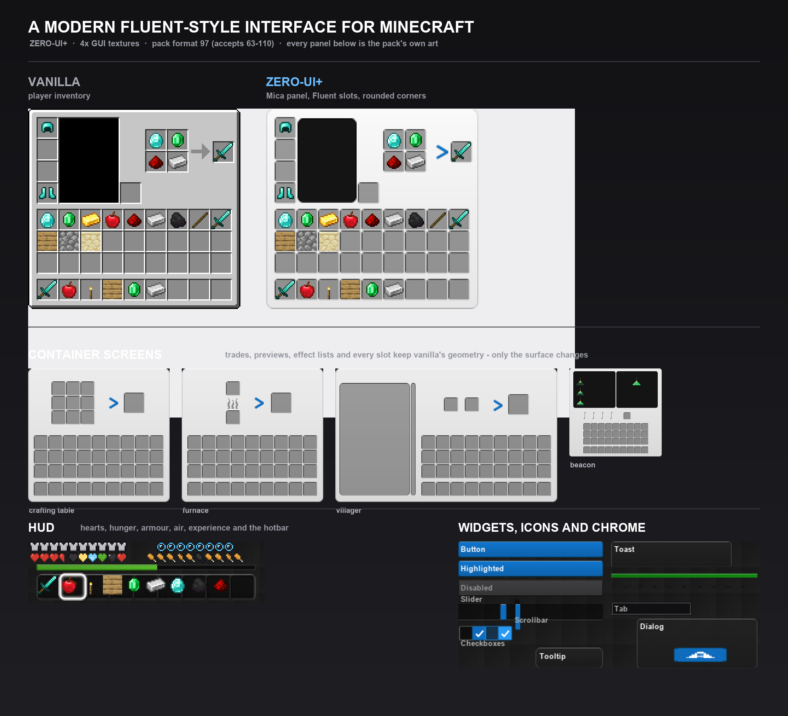

# ZERO-UI+

面向 Minecraft Java 版的现代化界面材质包，界面语言参考 Microsoft Fluent Design。



## 这是什么

ZERO-UI+ 用一套统一的 Fluent 视觉语言重绘了 Minecraft 的全部 GUI：容器界面、HUD、菜单、
提示框、吐司、进度条、成就与配方书。所有几何尺寸与原版逐像素对齐——Minecraft 的 GUI 布局是
硬编码的，任何尺寸偏差都会导致裁切或拉伸，因此本包只改变"表面"，不改变布局。

- **包装格式** 97（`min_format` 63，`max_format` 110），即 1.21.8 及以上客户端通用
- **分辨率** 界面主体（快捷栏、经验条、进度条、弹窗、吐司、成就背景等 104 张）为 4× 高清纹理，
  在 GUI 缩放或高 DPI 屏幕上不再出现锯齿与像素块
- **体积** 约 2.4 MB，511 张纹理
- **覆盖** `textures/gui/` 下 469/469 个精灵、26/26 个容器界面，全部替换；成书界面保持原版
- **零尺寸偏差** 构建时逐张校验尺寸与九宫格切片，不匹配即中止

## 设计原则

**表面重绘，几何不动。** 面板、按钮、进度条、槽位、滚动条这类大而平整的界面元素被完整重绘：
Mica 半透明底、圆角、1px 高光边、Fluent 强调色的内嵌槽位。

**形状即语义，所以字形只换色。** 46 种心形、饥饿/护甲/氧气点、列表箭头、配方书覆盖层、统计
图标这类元素有数百个，它们的外轮廓本身就是信息——气泡必须中空、覆盖层必须镂空，否则会挡住
底下的按钮。这些精灵保留原版 alpha 轮廓，仅映射到 Fluent 配色阶梯（健康红、饥饿橙、吸收金、
冰冻蓝、中毒绿、凋零灰、强调蓝）后重新着色，明暗层级按像素亮度还原。

**纹理都会给出实质信息，因此必须保真。** 村民交易列表、马匹与鹦鹉螺壳的实体预览区、信标效果
列表、合成器 3×3 网格、熔炉火焰与酿造气泡等原版内建图形都被逐像素保留，只调整其承载面板的
底色与描边。

**面板明暗跟随文字颜色。** Minecraft 把文本颜色硬编码进各类界面：容器标题与物品栏标签是深灰，
菜单/列表/提示框/吐司/按钮是白色。因此容器界面采用浅色 Mica 面板，其余界面采用深色
Acrylic 面板——保证任何一处文字都有足够对比度。成书界面（`gui/book.png`）保持原版不动。

**能高清的地方都高清。** 所有由脚本矢量绘制的界面元素都以 4 倍分辨率输出，客户端把它们映射回
逻辑尺寸，因此在 GUI 缩放 3、4 或视网膜屏上边缘依然平滑。三类纹理保持原版 1×，因为它们由客户端
按纹素切片，放大只会错位：容器面板（按 texel 直接 blit）、九宫格精灵（`border` 同时是屏幕像素数）、
动画精灵（帧矩形按 texel 计算）。

## 安装

1. 下载本仓库，或直接使用 `pack/` 目录
2. 将 `pack/` 重命名为 `ZERO-UI+.zip`（或将 `pack/` 复制到
   `.minecraft/resourcepacks/ZERO-UI+`）
3. 在「选项 → 资源包」中启用

## 自行构建

`pack/` 中的所有纹理都由 `tools/` 下的脚本从原版客户端 jar 生成，仓库不附带任何原版素材。

```sh
python3 tools/build.py --jar /path/to/client.jar --out pack
```

构建流程分为四步：

1. 运行各生成器，产出 511 张纹理
2. 尺寸校验：凡原版存在的精灵必须保持完全一致的像素尺寸，否则中止
3. 复用原版九宫格元数据：逐字复制每个被替换精灵的 `<sprite>.png.mcmeta`，让切片边界沿用
   官方定义
4. 字形换色与轮廓审计：按策略表决定每个精灵是"重绘"还是"保留轮廓换色"，再对所有重绘精灵做
   alpha 交并比审计，任何轮廓偏差都会被报告

```
tools/
  fluent.py            调色板、超采样绘制表面、材质配方、语义字形
  textures.py          控件与 HUD 生成器（第一部分）
  textures_ui.py       菜单、提示框、吐司、图标、社交界面
  extras.py            剩余精灵与成就界面
  containers.py        容器面板管线（槽位/内嵌区/预览底板的检测与重绘）
  restyle.py           字形换色策略表与 Fluent 配色阶梯
  build.py             装配、尺寸校验、九宫格继承、轮廓审计
  dump_manifest.py     从客户端 jar 导出原版精灵尺寸清单（维护用）
  vanilla_manifest.json  上一步的产物，textures.py 中硬编码尺寸的来源
```

## 许可

本项目采用 [MIT 许可证](LICENSE)，Copyright (c) 2026 lively-Studio。
